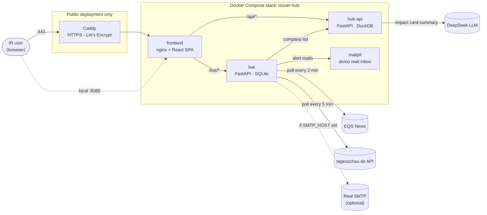
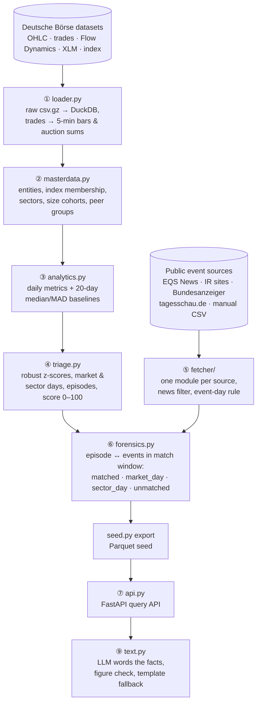
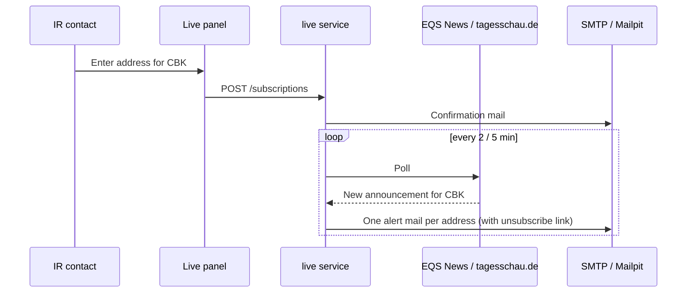

<div align="center">


# IssuerLens

**Issuer Intelligence Hub & corporate event impact tracker for DAX, MDAX and SDAX issuers**

Built at the Futury Build Days 2026 for the Deutsche Börse challenge
*"Issuer Intelligence Hub and corporate event impact tracker"*.


[Demo](#-demo) · [Features](#-features) · [Architecture](#-architecture) · [Quick start](#-quick-start) · [Deployment](#-public-deployment) · [Contributors](#-contributors)

</div>

---

## 💡 What it is

IssuerLens is a self-service view for **investor relations teams** of the 160 DAX, MDAX and SDAX companies. It answers two questions:

- **Part A, the dashboard:** How does our share trade on Xetra, day by day, compared with our peers?
- **Part B, the impact card:** How did trading react to a corporate event or a notable day? With an exportable short report.

Every figure is built from the Deutsche Börse datasets (Xetra OHLC, on-book trades, Flow Dynamics, XLM) and public event sources (EQS News, company IR sites, index changes, Bundesanzeiger, tagesschau.de). A live feed picks up new announcements as they are published and mails them to subscribed IR contacts.

## 🎬 Demo

<!--
  VIDEO PLACEHOLDER: replace this block once the demo video is ready.
  Option 1: drag the .mp4 (max. 10 MB) into the GitHub editor right here; GitHub inserts a playable player.
  Option 2: link a thumbnail to the hosted video:
    [](https://link-to-the-video)
-->

<div align="center">

> 🎥 **Demo video coming soon.**
> A walkthrough of the dashboard, the impact card, the event comparison and the live mail alerts.

</div>

Try it yourself with these deep links after [starting the stack](#-quick-start):

| Deep link | Shows |
|---|---|
| `#CBK` | Commerzbank dashboard |
| `#CBK/2026-02-11` | Impact card for a single day |
| `#PBB/2026-08-31/report` | Exportable report for an impact card |
| `#CBK/report` | IR snapshot |
| `#CBK/compare/earnings` | All results days compared |
| `#CBK/timing/earnings` | Results grouped by publication time |

ISINs work in place of tickers.

## ✨ Features

| Challenge item | Where in the app |
|---|---|
| **I.** Volume, spread and auction participation over time | Price chart with turnover bars; metric chart below (turnover, relative volume, spread at a chosen order size, auction share open/midday/close, participant shares) with 20-day baseline and index peer median |
| **II.** Peer benchmarking (sector, index, size) | "Peer comparison" panel: rank and median within the index, sector or turnover tercile; drag across the chart to compare a period |
| **III.** Flag anomalies | Dots under the price line and the "Unusual days & events" list, with the count line: event on the same day, market-wide day, sector-wide day, no event found |
| **IV. / VIII.** Shareable IR snapshot, exportable summary | "Export IR snapshot" and "Export report" on the impact card open a print view; "Print / Save as PDF" |
| **V.** Impact card | Click any day, dot or list row: turnover vs baseline, return split (market, sector, company), return vs index day 0 and day 0 to +5, spread, opening and closing auction turnover, opening gap, close vs VWAP, who traded and net flows, intraday 5-minute bars, AI-written summary |
| **VI.** Event calendar matched to trading data | Events from index changes, company IR sites and EQS News, shown on their effective trading day (after 17:35 Berlin: next trading day) |
| **VII.** Same-type comparison | "Compare events" or the button on an impact card: e.g. all results days in the DAX in 2026, by turnover, return, spread or auction turnover |
| **Extra:** Publication timing | "Publication timing" or "By publication time" on an event card: all results (ad hoc, M&A, ...) of an index grouped by when they were published in Berlin time (before the trading day, before 09:00, during trading), with medians of opening gap, turnover, return vs index, spread and auction shares per group, and every event as a clickable dot |
| **Extra:** Live feed & mail alerts | New EQS News and tagesschau.de announcements appear within minutes; IR contacts subscribe per stock and get a mail (see [Mail alerts](#-mail-alerts)) |

### Rules the UI keeps

- **Facts only.** Every number comes from the API and shows its date and source. Missing values read "no data" or "not checked", never 0.
- **Descriptive, not predictive.** No forecasts. An event is "on the same day as" an unusual day, never its cause.
- **The model words, it never calculates.** The AI summary receives fact objects only and is checked against the figures; if the check fails, the card falls back to a template sentence.
- **Clear time handling.** Trading days are dates; publication times are shown in Europe/Berlin.

## 🏗 Architecture

### Runtime



| Service | Image | What it does |
|---|---|---|
| `frontend` | `docker/frontend.Dockerfile` (Node build, nginx) | Serves the built React app; forwards `/api/*` to `hub-api` and `/live/*` to `live`. Single-page app: every deep link loads `index.html`. Optional site password (HTTP basic auth) from `BASIC_AUTH_USER`/`BASIC_AUTH_PASSWORD`. |
| `hub-api` | `docker/hub-api.Dockerfile` (Python 3.13) | The FastAPI app in `hub/backend`, with the exact package versions of `hub/uv.lock` (`docker/hub-api.requirements.txt`). The image builds `data/hub.duckdb` from the Parquet seed at build time. `DEEPSEEK_API_KEY` comes from `.env` at runtime and is not stored in the image. |
| `live` | `docker/live.Dockerfile` (Python 3.13) | Live feed (`live/`): polls the EQS News homepage every 2 min (one request covers all issuers, filtered to the 160 index stocks) and tagesschau.de business news every 5 min (API limit: 60 requests/hour). Stores new announcements in SQLite (volume `live-data`, raw responses gzipped next to it) and sends the mail alerts. Reuses the Hub fetcher's (`hub/backend`) EQS categories, title rules and tagesschau name list. |
| `mailpit` | `axllent/mailpit` | Catches the alert mails and shows them in a web UI, so the demo sends nothing real. |
| `caddy` | `caddy:2.11.9-alpine` (HTTPS overlay only) | Terminates TLS, obtains and renews the Let's Encrypt certificate, redirects HTTP to HTTPS. |

### Analytics pipeline (batch, `hub/scripts/build.sh`)

The Hub API serves finished tables. They are built offline by a numbered pipeline in `hub/backend/`, then exported as a Parquet seed that this repo ships to the container:



Key settings live in [`hub/config.yaml`](hub/config.yaml): 20-day baseline window, z-threshold 3, market-day share per index, sector-day threshold, event match windows per event type, the €25,000 order size for the spread metric and the 17:35 Berlin close cutoff.

### API surface

<details>
<summary><b>Hub API</b> (<code>/api/*</code>, docs at <code>http://localhost:8001/docs</code>)</summary>

| Method | Route | Purpose |
|---|---|---|
| GET | `/companies` | Universe: ISIN, ticker, name, index, sector, focus flag |
| GET | `/companies/{isin}/timeseries` | One metric per day with 20-day baseline, index peer median and anomaly flag |
| GET | `/indices/timeseries` | DAX vs MDAX vs SDAX: median of a metric over each index's members |
| GET | `/companies/{isin}/trend` | Last 20 trading days vs the 60 before (turnover, spread, auction share) |
| GET | `/companies/{isin}/peers` | Peer rank and distribution |
| GET | `/companies/{isin}/cases` | Unusual days and events with match status |
| GET | `/impact/{event_id}` | Impact card for an event |
| GET | `/impact/day/{isin}/{day}` | Impact card for any trading day |
| GET | `/compare` | All events of one type as a distribution, with percentiles |
| GET | `/timing` | Events grouped by publication time |
| GET | `/companies/{isin}/briefing` | How the stock's own past events of one type traded, plus the next known date |
| GET/POST | `/alerts`, `/alerts/load_next`, `/alerts/reset` | Prioritised alerts (HIGH/MED/LOW) for the focus stocks; demo replay of "Load new trading day" |
| GET/POST | `/ask/questions`, `/ask` | Example questions answered from the fact layer, every figure with date and source |

</details>

<details>
<summary><b>Live feed</b> (<code>/live/*</code>, status at <code>http://localhost:8003/status</code>)</summary>

| Method | Route | Purpose |
|---|---|---|
| GET | `/events` | Newest announcements |
| GET | `/status` | Poller state per source |
| GET/POST | `/subscriptions` | List and add mail alert addresses per stock |
| POST | `/subscriptions/test` | Send a [TEST] alert to all addresses of a stock |
| DELETE | `/subscriptions/{sub_id}` | Remove an address |
| GET | `/unsubscribe?token=…` | Unsubscribe link from the mails |

</details>

## 🚀 Quick start

> [!IMPORTANT]
> **The data seed is not in git.** It is processed Deutsche Börse data, this repo is public, and the data must not be passed on. Copy it from a teammate into `hub/data/reference/seed/` (or build it from the raw data, see [Data](#-data)) before you build.

### With Docker (recommended)

```bash
cp .env.example .env    # fill in DEEPSEEK_API_KEY; SMTP only for real mail
docker compose up --build -d
```

| What | URL |
|---|---|
| App | <http://localhost:8080> |
| Hub API docs | <http://localhost:8001/docs> |
| Live feed status | <http://localhost:8003/status> |
| Alert mails (Mailpit) | <http://localhost:8025> |

After code or data changes (also after a new seed): `docker compose up --build -d`. Stop: `docker compose down`.

### Without Docker

1. **Hub API** from `hub/` (the first request builds `hub/data/hub.duckdb` from the seed, a few seconds):

   ```bash
   python3.13 -m venv .venv && .venv/bin/pip install -r docker/hub-api.requirements.txt   # once
   cd hub && set -a && . ../.env && set +a && ../.venv/bin/uvicorn backend.api:app --port 8000
   ```

2. **Frontend:**

   ```bash
   cd frontend
   npm install
   npm run dev
   ```

3. **Live feed** (optional; skip it if the Docker `live` container runs, it serves port 8003 too):

   ```bash
   PYTHONPATH=hub:. LIVE_DATA_DIR=live-data .venv/bin/uvicorn live.app:app --port 8003
   ```

   Mail alerts need `SMTP_HOST` etc. in the environment (see `.env.example`; for Mailpit: `docker compose up -d mailpit` and `SMTP_HOST=127.0.0.1 SMTP_PORT=1025 SMTP_SECURITY=none`). Without `SMTP_HOST`, addresses are stored but no mail goes out.

4. Open <http://localhost:7777>.

The dev server forwards `/api/*` to `http://127.0.0.1:8000` and `/live/*` to `http://127.0.0.1:8003`. Other addresses: `HUB_API=http://host:port LIVE_API=http://host:port npm run dev`.

### Configuration

All settings go into `.env` next to `docker-compose.yml` (template: [`.env.example`](.env.example)).

| Variable | Default | Purpose |
|---|---|---|
| `DEEPSEEK_API_KEY` | empty | AI summary on the impact card; without it the card shows the template text |
| `SMTP_HOST`, `SMTP_PORT`, `SMTP_SECURITY`, `SMTP_USER`, `SMTP_PASSWORD`, `SMTP_FROM` | Mailpit | Real mail delivery; `SMTP_SECURITY` is `starttls` (587), `ssl` (465) or `none` |
| `PUBLIC_URL` | `http://localhost:8080` | Base URL for stock and unsubscribe links in mails |
| `APP_DOMAIN` | `www.justklaris.com` | Hostname for the HTTPS overlay (bare hostname, no scheme, port or path) |
| `DEPLOY_MODE` | `http` | Server mode for `scripts/server-setup.sh`: `http`, `caddy` or `tunnel` (see [Public deployment](#-public-deployment)) |
| `BASIC_AUTH_USER`, `BASIC_AUTH_PASSWORD` | empty | Site password in nginx; set it on every public server. Empty = open (localhost). No `:` in either |
| `ALERT_MAX_AGE_H` | `6` | Only announcements from the last N hours are mailed |

## 🌐 Public deployment

> [!IMPORTANT]
> **Set a site password on every public server** (`BASIC_AUTH_USER`, `BASIC_AUTH_PASSWORD` in `.env`). The app shows processed Deutsche Börse data, which must not be public, and `/live/subscriptions` lists the alert addresses. nginx then asks for the password on every page and API call; only the unsubscribe link in the mails works without it (its token is the key).

Three ways, picked by `DEPLOY_MODE` in `.env`:

| Mode | Overlay | When | Address |
|---|---|---|---|
| `http` | `docker-compose.http.yml` | Server with port 80 reachable, no domain (e.g. the JAIF build-days VM) | `PUBLIC_URL`, e.g. `http://<server-ip>:41080` |
| `caddy` | `docker-compose.https.yml` | Own domain, public ports 80 and 443 | `https://${APP_DOMAIN}` |
| `tunnel` | `docker-compose.tunnel.yml` | Own domain on Cloudflare, no open ports needed | `https://${APP_DOMAIN}` |

### One-command server setup

On a Linux server, [`scripts/server-setup.sh`](scripts/server-setup.sh) does all of it: installs Docker if needed, clones or updates this branch to `/srv/issuer-hub` (or `~/issuer-hub` without `/srv`), creates `.env` (asks for the mode, the public address or domain, the LLM key and the site password; mails stay in Mailpit), checks the seed and starts the stack. Run it again for updates.

```bash
# 1. on the laptop: copy the seed (not in git) to the server
rsync -az -e "ssh -p <ssh-port>" hub/data/reference/seed/ <user>@<server>:/srv/issuer-hub/hub/data/reference/seed/
# 2. on the server
bash <(curl -fsSL https://raw.githubusercontent.com/fjcyz7tk42-tech/Deutschb-rse/issuer-intelligence-hub/scripts/server-setup.sh)
```

If `rsync` cannot create `/srv/issuer-hub` (owned by root), run `sudo mkdir -p /srv/issuer-hub && sudo chown $USER /srv/issuer-hub` on the server first.

### JAIF build-days server (`http` mode)

The JAIF VMs publish only three ports: SSH (e.g. `41022`), `<ip>:41080 → VM port 80` and `<ip>:41443 → VM port 443`. Let's Encrypt cannot validate through the shifted ports, so Caddy cannot get a certificate there; use `http` mode (or `tunnel` with a Cloudflare domain for HTTPS).

```bash
docker compose -f docker-compose.yml -f docker-compose.http.yml up --build -d
```

- The frontend listens on VM port 80; both APIs and Mailpit listen on `127.0.0.1` only.
- `PUBLIC_URL=http://<server-ip>:41080` in `.env`, so the links in the alert mails work.
- **Mailpit** through an SSH tunnel: `ssh -p <ssh-port> -L 8025:localhost:8025 <user>@<server>`, then <http://localhost:8025>.
- Keep the repo on `/srv` (the data disk). Docker images go to the small system disk: `docker system prune` if it fills up.
- Keep the server's login data out of this repo and out of chats; it is public.

### Manual HTTPS with Caddy

Use the HTTPS overlay on a public Docker server where this stack owns ports 80/443 (Docker Compose 2.24.4 or newer):

```bash
docker compose -f docker-compose.yml -f docker-compose.https.yml up --build -d
```

- **DNS & ports:** The domain's A record (and AAAA record, if present) must point to the server, with inbound TCP 80 and 443 reachable. UDP 443 is optional for HTTP/3. Caddy obtains and renews the Let's Encrypt certificate once the stack runs on that reachable server ([Caddy's HTTPS requirements](https://caddyserver.com/docs/automatic-https#overview)).
- **Only Caddy is exposed.** The overlay removes the host ports of nginx, both APIs and Mailpit. Caddy forwards everything to nginx inside Docker; nginx preserves the original HTTPS scheme for the APIs.
- **Mail links** use `https://${APP_DOMAIN}`: the overlay sets the live service's `PUBLIC_URL` even if `.env` still holds the local URL. Configure real SMTP in `.env` for delivery; otherwise mails stay in Mailpit.
- **Certificates persist** in the `caddy-data` and `caddy-config` volumes; keep them when updating or restarting.

Use the same two `-f` options for updates, `logs` and `down`, so Compose keeps the HTTPS configuration:

```bash
docker compose -f docker-compose.yml -f docker-compose.https.yml logs --tail=100 caddy
docker compose -f docker-compose.yml -f docker-compose.https.yml down
```

### Cloudflare Tunnel (no public IP, no open ports)

For a server without a public IP (e.g. a hackathon machine), let Cloudflare handle the domain and HTTPS. In the Cloudflare dashboard: **Zero Trust → Networks → Tunnels → Create a tunnel → Cloudflared**, copy the token into `.env` as `TUNNEL_TOKEN`, and add the public hostname `APP_DOMAIN` with service **HTTP** `frontend:80`. Delete any existing A/AAAA record for that hostname first; the tunnel creates its own CNAME.

```bash
docker compose -f docker-compose.yml -f docker-compose.tunnel.yml up --build -d
docker compose -f docker-compose.yml -f docker-compose.tunnel.yml logs --tail=50 cloudflared
```

No host port is exposed; `cloudflared` connects outbound and forwards to nginx inside Docker. Use this overlay instead of `docker-compose.https.yml`, not together with it.

<details>
<summary><b>Other hosting setups</b></summary>

- **Platform terminates TLS:** use its HTTPS ingress to the frontend's container port 80 instead of adding Caddy. Set `PUBLIC_URL=https://www.justklaris.com` on the live service and route both API prefixes through the frontend. Keep API and Mailpit ports private using the platform's network settings; the base Compose file exposes them for local development.
- **Caddy already runs on the server:** merge the site block from [`docker/Caddyfile`](docker/Caddyfile) into that proxy's configuration and make the frontend reachable on its internal network. Replace any existing redirect for `www.justklaris.com` with the app route; do not start a second proxy on the same ports. Also set `PUBLIC_URL=https://www.justklaris.com` explicitly on the live service.

</details>

## 📬 Mail alerts



- In the live panel, addresses can be entered per stock ("Mail alerts for CBK"). When the live feed finds a new announcement for that stock, every address entered for it gets a mail with time, type, source and link (`live/notify.py`). Several announcements from one poll go into one mail; each address gets its own mail.
- A new address first gets a confirmation mail; every mail has an unsubscribe link per stock.
- **Not mailed:** holding notices (voting rights, directors' dealings, short positions) and announcements older than `ALERT_MAX_AGE_H` hours, so the first start does not mail the backlog. tagesschau.de articles are mailed as a link only, like in the UI.
- **Demo:** "Send test alert" sends a sample ad hoc announcement to every address of the stock through the same path as a real one, marked [TEST] and not stored in the feed.
- Subscriptions and a log of every mail (`alerts` table) are kept in the live SQLite database.

> [!NOTE]
> These are alerts on **new announcements**, not on unusual trading: the trading data ends on 30 Oct 2026, and unusual days come from the batch pipeline. Announcements after that date are listed, not matched.

> [!WARNING]
> Run only **one** live poller at a time (the Docker one or the local one, not both), so EQS and tagesschau.de get no duplicate requests.

## 🗂 Data

`hub/` holds the whole Hub API: the code (`backend/`, pipeline steps ①–⑨ and `api.py`), `config.yaml`, tests, docs and `data/reference/` with the finished tables as a Parquet seed (`data/reference/seed/`). The DuckDB database is built from the seed (`python -m backend.seed load`, also at Docker build time).

- **The seed is not in git** (processed Deutsche Börse data, this repo is public). Get it from a teammate, never through git, chat or a public link; copy it to servers with `rsync`/`scp`.
- **Rebuild it from the raw data** (in `hub/data/raw/`, also not in git):

  ```bash
  cd hub
  scripts/build.sh                    # raw csv.gz -> data/hub.duckdb (steps ①–⑨)
  uv run python -m backend.seed export  # database -> data/reference/seed/
  ```

- **Tests:** `cd hub && uv run pytest`.
- If the Hub API dependencies change (`hub/uv.lock`), refresh the pinned list for Docker:

  ```bash
  cd hub && uv export --frozen --no-dev --no-hashes --no-emit-project -o ../docker/hub-api.requirements.txt
  ```

## 📁 Project structure

```
.
├── frontend/src/
│   ├── api.ts                typed client for the Hub API
│   ├── liveApi.ts            typed client for the live feed
│   ├── format.ts             labels, units, dates (descriptive wording lives here)
│   ├── useFetch.ts           keyed data loading (no stale figures after a stock switch)
│   ├── App.tsx               layout, selection state, deep links
│   └── components/
│       ├── StockSelector.tsx stock search, grouped by DAX, MDAX, SDAX
│       ├── PriceChart.tsx    price line, turnover bars, case dots, period brush
│       ├── MetricChart.tsx   one metric vs baseline and peer median
│       ├── PeersPanel.tsx    peer rank and distribution
│       ├── CasesPanel.tsx    unusual days and events with the count line
│       ├── ImpactCard.tsx    Part B card
│       ├── IntradayChart.tsx 5-minute bars of the card's day
│       ├── ComparePanel.tsx  same-type event comparison
│       ├── TimingPanel.tsx   same-type events grouped by publication time
│       ├── ReportView.tsx    print view for the IR snapshot and the card
│       ├── LivePanel.tsx     newest announcements from the live feed
│       └── MailAlerts.tsx    addresses for mail alerts per stock
├── hub/                      Hub API
│   ├── backend/              pipeline steps ①–⑨ and api.py
│   ├── scripts/build.sh      raw data -> DuckDB
│   ├── tests/, docs/         pytest suite, API contract and data docs
│   ├── config.yaml           thresholds, event windows, LLM model
│   └── data/reference/       CSVs and the Parquet seed (seed not in git)
├── live/
│   ├── app.py                polling loop, /events, /status, /subscriptions, /unsubscribe
│   ├── sources.py            EQS News and tagesschau.de parsers
│   ├── store.py              SQLite: announcements, polls, subscriptions, sent mails
│   └── notify.py             alert and confirmation mails over SMTP
├── docker/                   Dockerfiles, nginx.conf, Caddyfile, pinned requirements
├── scripts/
│   └── server-setup.sh       one-command server setup (http, caddy or tunnel)
├── docker-compose.yml        local stack
├── docker-compose.http.yml   public HTTP on port 80 (JAIF server)
├── docker-compose.https.yml  public HTTPS overlay (Caddy)
└── docker-compose.tunnel.yml public HTTPS through a Cloudflare Tunnel
```

## 👥 Contributors

<table>
  <tr>
    <td align="center" width="200">
      <b>Jonas Lindemann</b>
    </td>
    <td align="center" width="200">
      <b>Philipp Müller</b>
    </td>
  </tr>
</table>

## ⚖️ Data notice

The figures are derived from Deutsche Börse datasets provided for the Futury Build Days 2026. The processed data is **not** part of this repository and must not be redistributed. Public event sources are fetched within their terms: EQS News slowly with permission confirmed by the team, tagesschau.de within its API limit of 60 requests/hour, keeping only title, time and link. Nothing in this app is investment advice.
